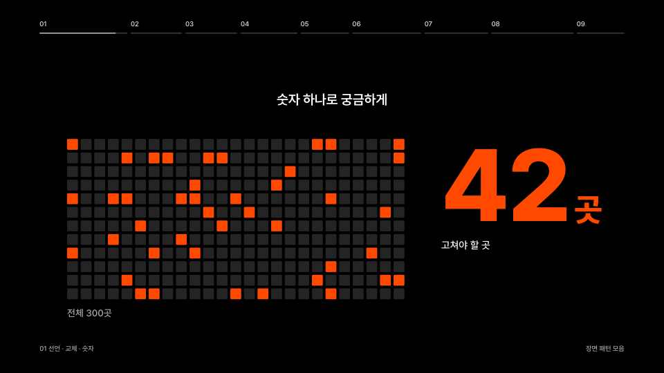
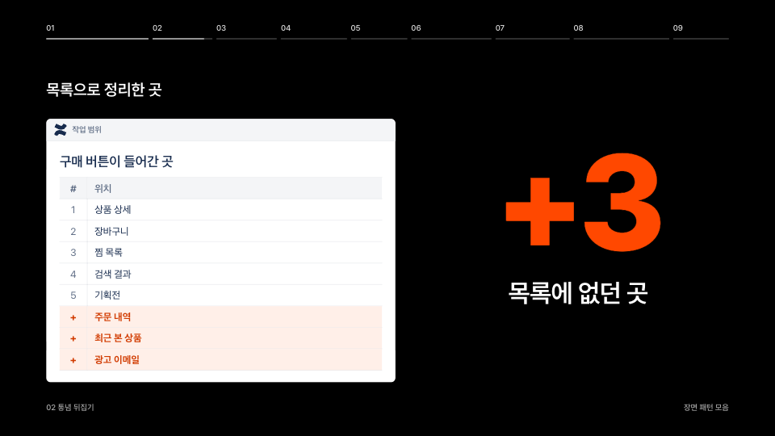
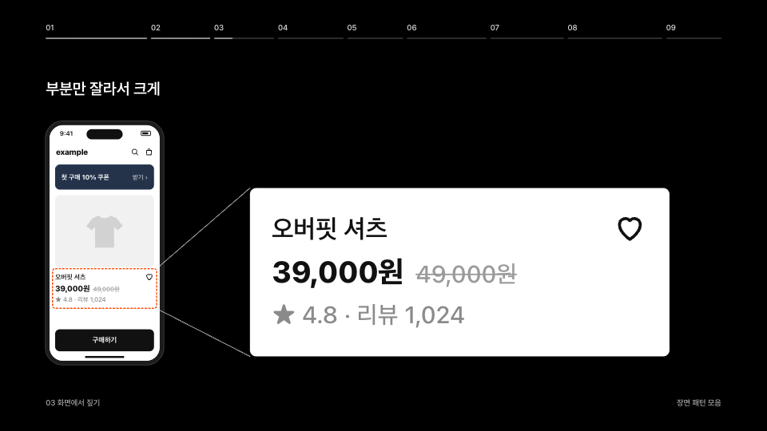
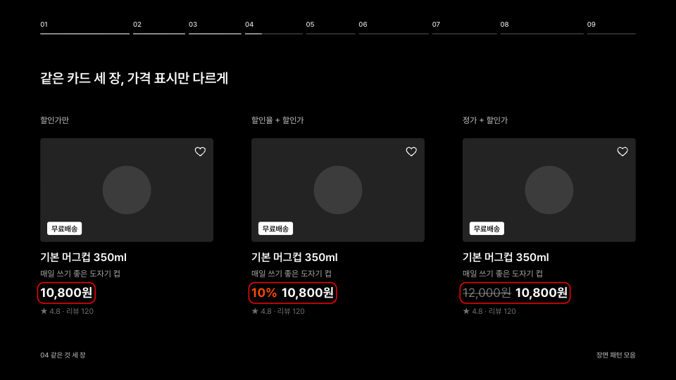
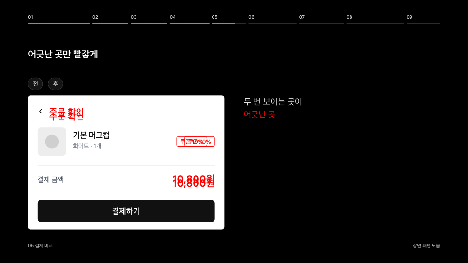
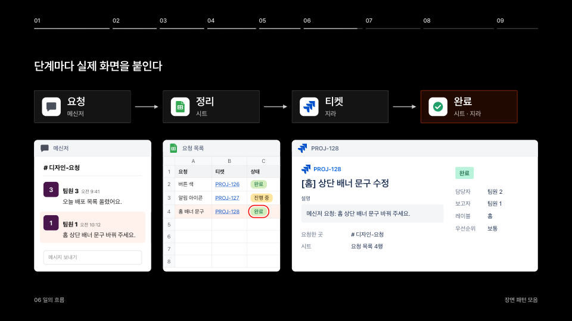
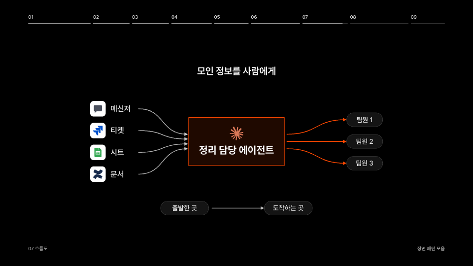
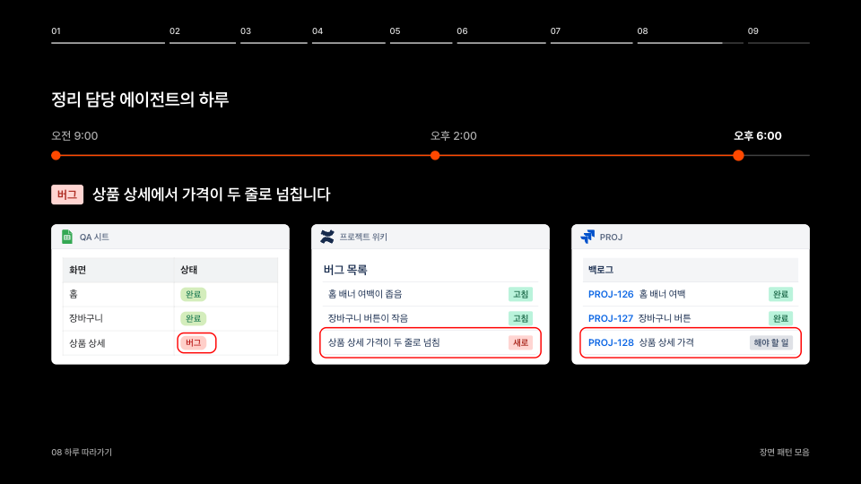
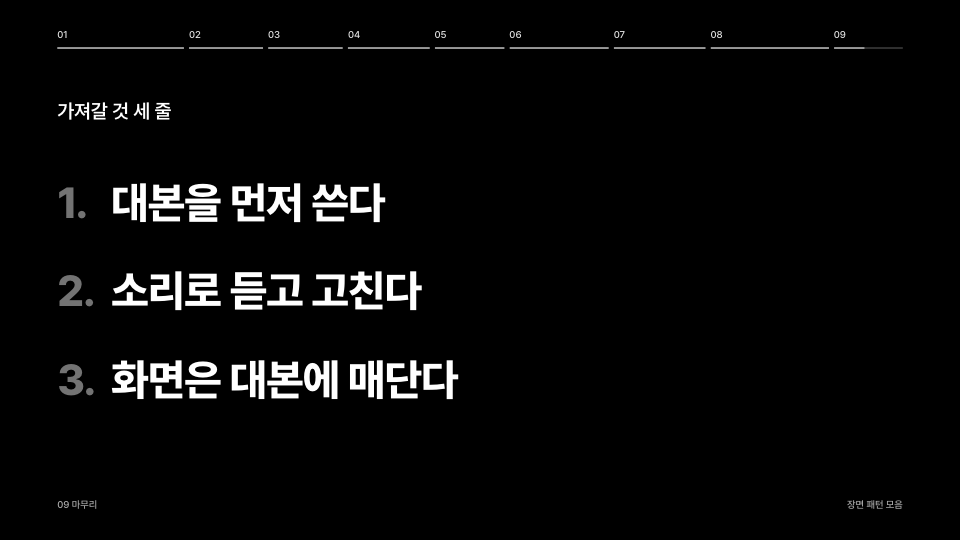

# johnnie-style-ppt

대본이 원본인 HTML 발표 장표를 만드는 [Claude Code](https://claude.com/claude-code) · Codex 스킬입니다.
장면이 대본 구절에 맞춰 넘어가고, 청중 화면과 발표자 화면을 나눠 띄우며, 리허설하면서 대본과 넘기는 기점을 바로 고칠 수 있습니다.

## 무엇을 하나

- **대본이 원본인 장표**: 1920×1080 HTML 장표. 대본(`deck/data.js`)의 구절에 장면 전환을 매달아, 대본을 고치면 전환 자리도 따라옵니다
- **발표 화면과 발표자 화면**: 발표자 화면에는 지금 문단 대본 · 다음에 누를 자리(▶) · 다음 문단 · 경과 시간이 나옵니다. 두 창은 어느 쪽에서 눌러도 같이 넘어갑니다
- **장면 패턴 9가지**: 비교 · 흐름도 · 하루 따라가기 같은 장면 짜임을 움직이는 견본 장표와 캡처로 담았습니다. 지난 발표에서 잰 시간차 · 밀도를 따라 같은 손맛으로 만들고, 찍어서 디자인 리뷰를 받습니다
- **리허설하며 고치기**: 발표자 화면에서 대본 문장을 고치고 ▶ 를 끌어 옮기면, 그 내용을 대본과 장면에 반영합니다
- **음성**: Typecast TTS 로 길이를 재고, 음성이 자동으로 흐르는 '프레젠테이션' 모드를 만듭니다(선택)
- **공유용 한 파일**: 서체 · 이미지 · 음성을 HTML 하나에 넣습니다. 서체가 빠지면 만들지 않고, 서체가 없는 기기 조건으로 다시 열어 확인합니다
- **같이 들어 있는 것**: 대본 구성과 이야기 장치, 상황별 디자인 스킬 추천(설치는 선택), 실제 발표에서 겪은 실패와 교훈

## 장면 패턴

장면 짜임 9가지를 일반 예로 만든 견본이 들어 있습니다. 스킬이 문단마다 패턴을 골라 같은 손맛으로 장면을 만듭니다. 패턴마다 언제 쓰는지 · 박자 · 기법은 [references/patterns.md](references/patterns.md).

<table>
<tr>
<td align="center"><br>01 선언 · 교체 · 숫자</td>
<td align="center"><br>02 통념 뒤집기</td>
<td align="center"><br>03 화면에서 짚기</td>
</tr>
<tr>
<td align="center"><br>04 같은 것 세 장</td>
<td align="center"><br>05 겹쳐 비교</td>
<td align="center"><br>06 일의 흐름</td>
</tr>
<tr>
<td align="center"><br>07 흐름도</td>
<td align="center"><br>08 하루 따라가기</td>
<td align="center"><br>09 마무리</td>
</tr>
</table>

움직임은 견본 장표로 직접 넘겨 보면 됩니다. 아래로 만든 뒤 Chrome 으로 `deck/index.html` 을 열고 → · Space 로 넘깁니다.

```bash
python3 ~/.claude/skills/johnnie-style-ppt/scripts/new_deck.py ~/Desktop/pattern-gallery --gallery
```

## 필요한 것

- macOS, Python 3.9 이상, Node 22 이상, Google Chrome, git
- 장표 서체(기본 [Pretendard](https://github.com/orioncactus/pretendard)) 설치
- 음성을 쓰려면 [Typecast](https://typecast.ai) API 키(선택). 키는 맥 키체인에 넣습니다(`references/script.md`)

## 설치

Claude Code:

```bash
git clone https://github.com/johnnieDesign/johnnie-style-ppt.git ~/.claude/skills/johnnie-style-ppt
bash ~/.claude/skills/johnnie-style-ppt/install.sh   # Codex 연결 + 필요한 것 확인(선택)
```

에이전트에게 "이 저장소 스킬로 설치해 줘: https://github.com/johnnieDesign/johnnie-style-ppt" 라고 해도 됩니다.

## 업데이트

```bash
git -C ~/.claude/skills/johnnie-style-ppt pull
```

스킬이 시작할 때 새 버전이 있으면 알려 줍니다. 바뀐 내용은 [CHANGELOG.md](CHANGELOG.md).

## 쓰는 법

Claude Code 에서 이렇게 말하면 됩니다.

- "다음 주 공유회 발표 장표 만들어줘"
- "발표 대본 써줘" · "대본 음성으로 들어 보자"
- "발표자 화면 띄워줘" · "발표자 화면에서 고친 대본 반영해줘"
- "장표 디자인 · 애니메이션 다듬자"
- "장표 공유용으로 한 파일 만들어줘"

발표 하나는 폴더 하나입니다. 스킬이 `scripts/new_deck.py` 로 만들고, 엔진 · 도구 · 대본 · 음성이 그 안에 모입니다. 폴더를 통째로 옮기면 어느 맥에서나 열립니다.

## 폴더

| 경로 | 내용 |
| --- | --- |
| `SKILL.md` | 스킬 흐름 |
| `references/` | 엔진 · 대본 · 디자인 스킬 추천 · 장면 패턴 · 디자인 리뷰 · 실패와 교훈 · 발표 준비와 공유 |
| `gallery/` | 장면 패턴 견본(대본 `data.js` · 장면 `scenes/` · 캡처 `shots/`) |
| `scripts/` | 새 발표 폴더 · 패턴 견본 장표 만들기(`new_deck.py`) · 디자인 스킬 확인과 받기(`design_skills.py`) |
| `template/` | 발표 폴더 템플릿(`deck/` 엔진과 견본 2파트, `tools/` 음성 · 대본 반영 · 촬영 · 공유본 도구) |

## 교훈 보내기

발표가 끝나면 스킬이 그 기기의 `~/.johnnie-style-ppt/lessons.md` 에 교훈을 남깁니다. 다른 사람에게도 도움이 될 것 같으면 [이슈](https://github.com/johnnieDesign/johnnie-style-ppt/issues)로 보내 주세요. 회사 · 고객 · 개인 정보는 빼고 적어 주세요.

## 라이선스

[MIT](LICENSE).

- 서비스 로고는 Simple Icons(CC0)와 직접 그린 아이콘입니다. 출처는 `template/deck/assets/logos/SOURCE.md`. 상표는 각 회사의 것입니다
- 디자인 스킬(frontend-design · hallmark · impeccable 등)은 이 저장소에 들어 있지 않습니다. 사용자가 고를 때 각 원본 저장소에서 받습니다
- Pretendard 는 SIL Open Font License 이고 이 저장소에 들어 있지 않습니다
